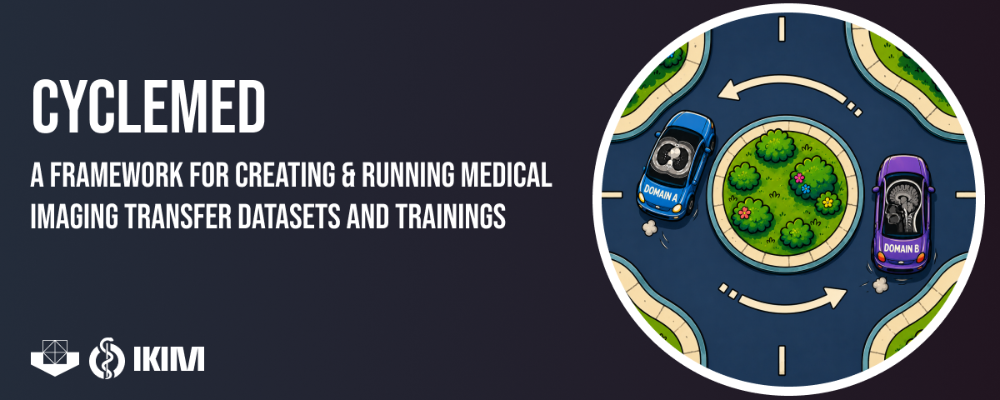

# Medical Image Translation CycleGAN Pipeline


CycleMED is a CycleGAN pipeline for medical image translation with MRI and CT data. It converts NIfTI volumes into 16-bit grayscale PNG datasets, supports optional ANTs co-registration, trains one-channel CycleGAN models, and reconstructs generated slices back into geometry-preserving NIfTI volumes.

The pipeline follows the standard CycleGAN domain convention. Domain `A` is the source domain, and domain `B` is the target domain.

The same workflow can be used for other MRI or CT image-translation tasks when the input data are prepared as two domains. Depending on the use case, MRI data can be normalized with fixed bounds, maximum normalization, or percentile normalization. CT data should use fixed HU windows.

## Installation

Use Python 3.10 or newer with PyTorch. The medical imaging pipeline also uses `antspyx`, `SimpleITK`, and OpenCV.

Install the environment with `uv`:

```bash
uv sync
uv run python pipeline.py --help
```

Run the local smoke test to check the main workflow on synthetic NIfTI data:

```bash
uv run python tests/smoke_pipeline.py
```

Visdom live display is optional in the `uv` environment. If Visdom is not installed, training disables live display and still writes checkpoint HTML/image previews. Set `--display_id -1` to disable live display explicitly.

## Expected Data Layout

Dataset generation writes the standard CycleGAN folder structure. Training reads images from `trainA` and `trainB`; validation and test folders are created in the same style.

```text
/path/to/domain_translation_dataset/
  trainA/
  trainB/
  valA/
  valB/
  testA/
  testB/
```

The helper scripts expect one folder per case and two domain folders inside each case. Keep the same source-target meaning for `A` and `B`, or adjust the filename patterns in the preprocessing script to match your local naming.

Co-registration is optional. Use it when source and target volumes should be aligned into a shared target-domain space before dataset export. If the volumes are already aligned, or if the task is intentionally unpaired and unregistered, you can skip registration and run dataset export directly.

## Dataset Generation

When co-registration is needed, the preparation command can run registration and PNG export together:

```bash
uv run python pipeline.py prepare-dataset \
  --curated-root /path/to/curated_domain_niftis \
  --registered-root /path/to/registered_domain_niftis \
  --dataroot /path/to/domain_translation_dataset \
  --registration-type SyN \
  --intensity-threshold 10.0 \
  --source-folder source_domain \
  --source-image source.nii.gz \
  --target-folder target_domain \
  --target-image target.nii.gz \
  --registered-source-folder source_domain \
  --registered-source-image source_registered.nii.gz \
  --registered-target-folder target_domain \
  --registered-target-image target_reference.nii.gz \
  --skip-existing \
  --train-ratio 0.8 \
  --val-ratio 0.1 \
  --split-seed 42 \
  --modality mri \
  --normalization percentile \
  --percentile UPPER_PERCENTILE \
  --percentile-reference independent \
  --drop-black-slices \
  --target-size 256 256
```

The same workflow can also be run as two separate steps:

```bash
uv run python pipeline.py register \
  --curated-root /path/to/curated_domain_niftis \
  --registered-root /path/to/registered_domain_niftis \
  --registration-type SyN \
  --intensity-threshold 10.0 \
  --source-folder source_domain \
  --source-image source.nii.gz \
  --target-folder target_domain \
  --target-image target.nii.gz \
  --registered-source-folder source_domain \
  --registered-source-image source_registered.nii.gz \
  --registered-target-folder target_domain \
  --registered-target-image target_reference.nii.gz \
  --skip-existing

uv run python pipeline.py make-dataset \
  --registered-root /path/to/registered_domain_niftis \
  --dataroot /path/to/domain_translation_dataset \
  --source-folder source_domain \
  --source-image source_registered.nii.gz \
  --target-folder target_domain \
  --target-image target_reference.nii.gz \
  --train-ratio 0.8 \
  --val-ratio 0.1 \
  --split-seed 42 \
  --modality mri \
  --normalization percentile \
  --percentile UPPER_PERCENTILE \
  --percentile-reference independent \
  --drop-black-slices \
  --target-size 256 256
```

If registration is not needed, run `make-dataset` directly on a root folder that already follows the expected NIfTI layout.

### Normalization

The dataset exporter supports MRI and CT data. MRI datasets can use fixed bounds, maximum normalization, or percentile normalization. CT datasets should use fixed HU boundaries so that all volumes are mapped with the same intensity window.

Fixed normalization clips each domain to explicit lower and upper bounds before scaling to `[0, 1]`. Maximum normalization is available for MRI and scales each volume by its nonzero maximum. Percentile normalization is also MRI-specific and clips each volume to explicitly selected percentile bounds.

MRI normalization can be selected depending on the use case. Percentile values can be written either as fractions (`0.99`) or percent values (`99`):

```bash
uv run python pipeline.py make-dataset \
  --registered-root /path/to/registered_domain_niftis \
  --dataroot /path/to/domain_translation_dataset \
  --source-folder source_domain \
  --source-image source_registered.nii.gz \
  --target-folder target_domain \
  --target-image target_reference.nii.gz \
  --train-ratio 0.8 \
  --val-ratio 0.1 \
  --split-seed 42 \
  --modality mri \
  --normalization percentile \
  --percentile UPPER_PERCENTILE \
  --percentile-reference independent \
  --drop-black-slices \
  --target-size 256 256
```

The percentile reference controls whether the two domains use their own bounds or share bounds from one domain:

- `--percentile-reference independent`: compute percentile bounds separately for A and B.
- `--percentile-reference follow-a`: compute percentile bounds from A and apply those same bounds to A and B for that patient.
- `--percentile-reference follow-b`: compute percentile bounds from B and apply those same bounds to A and B for that patient.

MRI maximum normalization:

```bash
uv run python pipeline.py make-dataset \
  --registered-root /path/to/registered_domain_niftis \
  --dataroot /path/to/domain_translation_dataset \
  --source-folder source_domain \
  --source-image source_registered.nii.gz \
  --target-folder target_domain \
  --target-image target_reference.nii.gz \
  --train-ratio 0.8 \
  --val-ratio 0.1 \
  --split-seed 42 \
  --modality mri \
  --normalization max \
  --drop-black-slices \
  --target-size 256 256
```

CT normalization uses fixed HU windows:

```bash
uv run python pipeline.py make-dataset \
  --registered-root /path/to/registered_domain_niftis \
  --dataroot /path/to/domain_translation_dataset \
  --source-folder source_domain \
  --source-image source_registered.nii.gz \
  --target-folder target_domain \
  --target-image target_reference.nii.gz \
  --train-ratio 0.8 \
  --val-ratio 0.1 \
  --split-seed 42 \
  --modality ct \
  --normalization fixed \
  --a-min SOURCE_MIN_HU \
  --a-max SOURCE_MAX_HU \
  --b-min TARGET_MIN_HU \
  --b-max TARGET_MAX_HU \
  --drop-black-slices \
  --target-size 256 256
```

Other dataset-generation options control the output size, slice subsampling, and whether paired black slices are dropped or kept.

## CycleMED Options

CycleMED keeps the original CycleGAN training interface and adds a small set of options for medical image workflows.

Dataset preparation options:

- `--registration-type`: selects the ANTs registration transform for co-registration. The pipeline currently exposes `SyN` and `SyNRA`.
- `--intensity-threshold`: masks very low source-domain intensities during registration.
- `--overwrite` / `--skip-existing`: choose whether existing registered NIfTI outputs are replaced or reused.
- `--split-seed`: controls the random train, validation, and test split during dataset generation.
- `--modality`: selects the imaging modality. Use `mri` for MRI normalization modes and `ct` for CT data.
- `--normalization`: selects how NIfTI intensities are mapped before PNG export. Use `fixed`, `max`, or `percentile` for MRI. Use `fixed` for CT.
- `--percentile`: sets the upper percentile for MRI percentile normalization. For example, `0.99` and `99` both refer to the 99th percentile.
- `--percentile-range`: sets lower and upper percentile bounds explicitly when a lower bound other than zero is needed.
- `--percentile-reference`: controls whether percentile bounds are computed separately for both domains (`independent`) or shared from domain A (`follow-a`) or domain B (`follow-b`).
- `--a-min`, `--a-max`, `--b-min`, `--b-max`: define fixed intensity ranges for domain A and domain B. These are required for CT fixed HU normalization and for reconstructing generated PNGs back into the original intensity scale.
- `--drop-black-slices` / `--keep-black-slices`: choose whether paired slices are removed when either domain is completely black.
- `--keep-every-nth-slice`: exports only every nth slice when a thinner training set is wanted.
- `--target-size`: sets the exported PNG size as `WIDTH HEIGHT`.

Training and inference options:

- `--input_nc 1 --output_nc 1`: trains and tests one-channel grayscale models for 16-bit medical PNG slices.
- `--random-seed`: sets an optional training seed for Python, NumPy, PyTorch, CUDA, data-loader shuffling, and data-loader workers. The manuscript experiments were run without a fixed training seed, but new runs can set this flag explicitly.
- `--deterministic-backend`: asks PyTorch and cuDNN to use deterministic kernels where available. This does not choose the random numbers itself; use it together with `--random-seed` when you want a repeatable run.
- `--use_bilinear_upsampling`: switches the ResNet generator decoder from the default transposed-convolution upsampling to bilinear upsampling followed by convolution. If this flag is not set, CycleGAN uses transposed convolutions for generator upsampling.
- `--scale_to_hu`: keeps result image saving compatible with workflows that visualize outputs in an HU-like scale.
- `--verbose`: prints additional image loading and conversion details.

`--random-seed` and `--deterministic-backend` control different parts of reproducibility. The random seed fixes the random choices made by the training run, including model initialization, shuffling, workers, and stochastic transforms. The deterministic backend option asks PyTorch to avoid nondeterministic GPU kernels where this is supported.

Reconstruction options:

- `--no-restore-original-range`: writes reconstructed NIfTI volumes in normalized `[0, 1]` space instead of mapping them back with `--a-min`, `--a-max`, `--b-min`, and `--b-max`.
- `--source-reference-folder`, `--source-reference-image`, `--target-reference-folder`, `--target-reference-image`: point reconstruction to the registered reference NIfTIs whose spacing, origin, and direction should be copied.

## Training

Train a one-channel CycleGAN model with the generated dataset:

```bash
uv run python train.py \
  --dataroot /path/to/domain_translation_dataset \
  --name domain_a_to_domain_b \
  --model cycle_gan \
  --dataset_mode unaligned \
  --direction AtoB \
  --input_nc 1 \
  --output_nc 1 \
  --netG resnet_9blocks \
  --netD basic \
  --norm instance \
  --use_bilinear_upsampling \
  --random-seed 42 \
  --deterministic-backend
```

The unaligned dataset loader reads 16-bit grayscale PNGs and returns one-channel tensors in `[-1, 1]`. Use `--gpu_ids -1` for CPU training, or set the CUDA devices available on your machine. Omit `--random-seed` to run without a fixed training seed.

## Inference and NIfTI Reconstruction

After training, run inference with the same dataset and experiment name:

```bash
uv run python test.py \
  --dataroot /path/to/domain_translation_dataset \
  --name domain_a_to_domain_b \
  --model cycle_gan \
  --dataset_mode unaligned \
  --input_nc 1 \
  --output_nc 1 \
  --use_bilinear_upsampling \
  --num_threads 0 \
  --batch_size 1 \
  --serial_batches \
  --no_flip \
  --display_id -1 \
  --results_dir /path/to/results
```

Generated target-domain images are saved with the `fake_B` suffix. They can be stacked back into NIfTI volumes while copying spacing, origin, and direction from registered reference NIfTIs:

```bash
uv run python pipeline.py reconstruct-nifti \
  --images-dir /path/to/results/domain_a_to_domain_b/test_latest/images \
  --reference-root /path/to/registered_domain_niftis \
  --output-dir /path/to/reconstructed_domain_niftis \
  --source-reference-folder source_domain \
  --source-reference-image source_registered.nii.gz \
  --target-reference-folder target_domain \
  --target-reference-image target_reference.nii.gz \
  --a-min SOURCE_MIN \
  --a-max SOURCE_MAX \
  --b-min TARGET_MIN \
  --b-max TARGET_MAX
```

For CT reconstruction, pass the same HU window that was used during dataset generation. Use `--no-restore-original-range` when reconstructed volumes should remain in `[0, 1]`.

## Citation

This repository accompanies work that is currently under review. If you use it, please cite the manuscript once the final publication details are available.

**Accelerated Body Composition Analysis in Whole-Body MRI Using CycleGAN-Based T2-HASTE Synthesis from Fast Whole-Body Localizers**

```bibtex
@misc{cyclemed_body_composition_mri,
  title={Accelerated Body Composition Analysis in Whole-Body MRI Using CycleGAN-Based T2-HASTE Synthesis from Fast Whole-Body Localizers},
  author={TODO},
  year={TODO},
  note={Under review}
}
```

CycleMED builds on the excellent [pytorch-CycleGAN-and-pix2pix](https://github.com/junyanz/pytorch-CycleGAN-and-pix2pix) repository by Jun-Yan Zhu, Taesung Park, and collaborators. The upstream project provides the CycleGAN model structure, training loop, option system, visualization utilities, and dataset framework used here.

Please also cite the original CycleGAN paper:

```bibtex
@inproceedings{CycleGAN2017,
  title={Unpaired Image-to-Image Translation using Cycle-Consistent Adversarial Networks},
  author={Zhu, Jun-Yan and Park, Taesung and Isola, Phillip and Efros, Alexei A},
  booktitle={IEEE International Conference on Computer Vision},
  year={2017}
}
```

## License

CycleMED builds on [pytorch-CycleGAN-and-pix2pix](https://github.com/junyanz/pytorch-CycleGAN-and-pix2pix), preserves the upstream notices in `LICENSE`, and distributes the CycleMED additions under the same BSD-style terms.
